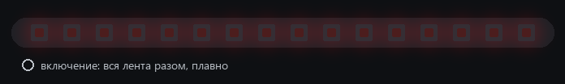
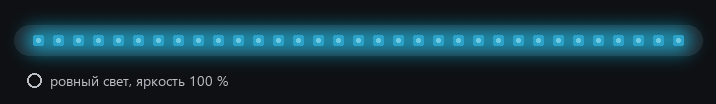
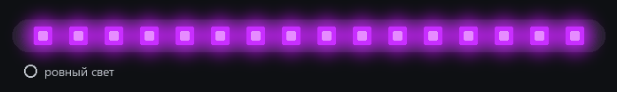
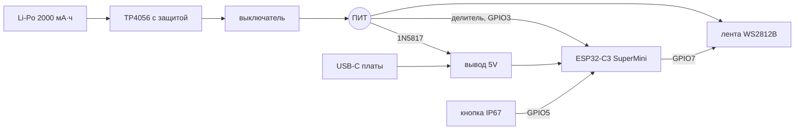
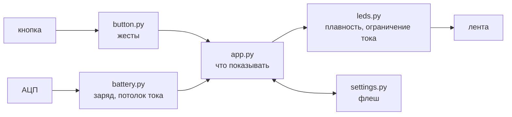

# Светящийся ошейник

[](https://github.com/Ithinkimbulletproof/light-up_collar/actions/workflows/tests.yml)


[](LICENSE)

Ошейник для собаки с подсветкой на адресной ленте. С собакой гуляем в полях, где ночью совсем темно, и хотелось видеть её издалека. Ошейник горит ровным светом выбранного цвета, управляется одной герметичной кнопкой и работает от Li-Po на 2000 мА·ч. Bluetooth и приложения нет: всё, что нужно, делается кнопкой.

Прошивка написана на MicroPython для ESP32-C3. Логика отделена от железа, поэтому её можно запускать на компьютере. Так работают тесты, и так же нарисованы анимации ниже: это те самые модули, которые пойдут на плату, только кнопку нажимает сценарий, а кадры вместо ленты попадают в GIF.



Прошивка и документация готовы, логика покрыта тестами. Сборка и проверка на железе — следующий этап, см. [статус](#статус).

## Управление

| Что сделать | Что произойдёт |
| --- | --- |
| Включить красной кнопкой | лента загорается вся сразу, плавно, с последними цветом и яркостью |
| Нажать белую кнопку один раз | следующий цвет: новый цвет пробегает по ленте от начала до конца за полсекунды |
| Нажать дважды | следующий уровень яркости: 10, 35, 100 % и снова 10. Лента мигает 1, 2 или 3 раза, чтобы в темноте было понятно, какой уровень выбран |
| Подержать 1,5 с | показ заряда на 5 секунд |
| Нажать во время показа заряда | показ пропадает, больше ничего не меняется |
| Включить с зажатой кнопкой | безопасный старт: прошивка не запускается, плата доступна по USB |

Цветов восемь: красный, оранжевый, жёлтый, зелёный, голубой, синий, фиолетовый, белый. Цвет и яркость сохраняются через 5 секунд после последнего нажатия.



Заряд показывается длиной и цветом полосы. При 80 % горят 80 % светодиодов, остальные погашены. Цвет зависит от четверти: зелёный от 75 %, жёлтый от 50 %, оранжевый от 25 %, ниже — красный.



## Железо

| Узел | Что стоит |
| --- | --- |
| Контроллер | ESP32-C3 SuperMini |
| Свет | лента WS2812B, 60 светодиодов на метр, 33 штуки |
| Питание | Li-Po 1S 2000 мА·ч, модуль заряда TP4056 с защитой, диод Шоттки 1N5817 |
| Управление | кнопка IP67 без фиксации на GPIO5, выключатель с фиксацией в разрыве питания |
| Замер батареи | делитель 100 кОм / 100 кОм на GPIO3 |



Самое неочевидное в схеме — вывод 5V на SuperMini. Это не выход стабилизатора, а прямо линия питания USB-C. Если подключить батарею к нему напрямую, компьютер через USB начнёт заряжать Li-Po в обход контроллера заряда. Поэтому батарея питает плату через диод Шоттки, и USB можно вставлять в любой момент. Схема целиком, список деталей и проверки мультиметром перед первым включением — в [docs/wiring.md](docs/wiring.md), устройство кнопки — в [docs/button.md](docs/button.md).

## Как устроена прошивка

С железом работает только [`main.py`](firmware/main.py). Это один цикл без asyncio: кнопка опрашивается каждые 5 мс, кадр выводится каждые 25 мс, батарея меряется раз в 250 мс. Остальные модули не импортируют `machine` и одинаково работают на плате и на компьютере.



Несколько задач оказались сложнее, чем выглядят со стороны.

### Ток и просадка батареи

Белым на полной яркости лента потянула бы около 2 А, а батарея с платой защиты и тонкими проводами начинает проседать гораздо раньше. Поэтому перед каждым кадром прошивка оценивает полный ток (до 20 мА на канал, плюс ток покоя ленты и самой платы) и, если он выше 700 мА, пропорционально приглушает весь кадр.

Если напряжение под нагрузкой всё равно падает ниже 3,45 В, потолок снижается ступенями. Вернуть его обратно сложнее: стоит убавить ток, как напряжение тут же подскакивает, наивная проверка поднимает потолок, и всё начинается сначала. Поэтому потолок растёт, только если прогноз напряжения под новым током (`V_rest − I × R_int`) не ниже 3,6 В. Модель батареи с внутренним сопротивлением в тестах проверяет, что потолок не раскачивается.

### Никакого мигания чаще 3 Гц

Свет находится рядом с глазами собаки, резких вспышек быть не должно. Проверять каждый эффект по отдельности ненадёжно, поэтому ограничение стоит на выходе: любой канал любого светодиода меняется не быстрее чем на 255 за 350 мс. Через этот фильтр проходит всё — смена цвета, мигание при смене яркости, индикаторы батареи, частые нажатия. Тест прогоняет итоговые кадры ленты и считает частоту. Чтобы убедиться, что он действительно ловит нарушения, его запускали против намеренно ослабленной плавности.

### Заряд под нагрузкой

Под током 0,7 А напряжение Li-Po заметно ниже, чем в покое, и проценты прыгали бы от каждой смены цвета. Прошивка пересчитывает напряжение без нагрузки, `V_rest ≈ V + I × R_int`, сглаживает его и по нему считает проценты и флаги.

При «низком заряде» (около 7 %) лента раз в 30 секунд мягко вспыхивает красным. При «разряжен» (около 3 %) лента гаснет, и это состояние держится до выключения питания. Без такой защёлки погасшая лента подняла бы напряжение, ошейник снова включился бы, просел и погас, и так по кругу.

### Настройки во флеше

Цвет и яркость пишутся в `settings.json` не сразу, а через 5 секунд после последнего нажатия, чтобы не изнашивать флеш, пока цвета листают. Запись атомарная: сначала во временный файл, потом переименование. Ниже 3,5 В запись откладывается: просадка посреди записи может испортить файловую систему, а сама она не восстанавливается.

### Кнопка

Одиночное нажатие, двойное и удержание различает небольшой конечный автомат с антидребезгом. Чтобы отличить одиночное от двойного, приходится ждать 350 мс после отпускания, поэтому цвет меняется с небольшой задержкой. Удержание никогда не засчитывается как часть двойного, а третье нажатие подряд игнорируется.

## Тесты

```bash
python -m pytest firmware/tests -q
```

Каждый модуль тестируется отдельно, а [`test_main.py`](firmware/tests/test_main.py) запускает настоящий `main.py` с поддельными `machine`, `neopixel` и `time`: прошивка должна стартовать, реагировать на кнопку и сохранять настройки. На каждый push GitHub Actions прогоняет тесты и собирает все файлы через `mpy-cross` 1.29 — тем же компилятором, что внутри MicroPython на плате.

Анимации для этого README рисует [`tools/render_demo.py`](tools/render_demo.py).

## Структура

```
firmware/
  main.py          работа с железом и главный цикл
  app.py           реакция на кнопку и что показывать на ленте
  button.py        жесты кнопки
  leds.py          яркость, плавность, ограничение тока, вывод на ленту
  battery.py       напряжение, проценты, флаги, адаптивный потолок тока
  modes.py         кадры: ровный свет, перекраска, шкала заряда, индикаторы
  settings.py      сохранение цвета и яркости
  config.py        пины и все константы
  bringup/         скрипты проверки железа по одному узлу
  tests/           тесты на pytest
tools/
  upload.py        копирование прошивки на плату
  render_demo.py   анимации для README
docs/
  spec.md          техническое задание
  wiring.md        подключение и правила безопасности
  button.md        кнопка: выбор, схема, механика
  setup.md         прошивка платы, проверки, калибровка
```

## Запуск

Коротко, для Windows. Подробно, с проверками железа и разбором проблем, — в [docs/setup.md](docs/setup.md).

```powershell
py -m venv .venv
.venv\Scripts\python -m pip install -r tools\requirements.txt
.venv\Scripts\esptool --chip esp32c3 --port COM5 erase-flash
.venv\Scripts\esptool --chip esp32c3 --port COM5 write-flash 0 ESP32_GENERIC_C3-20260824-v1.29.0.bin
.venv\Scripts\python tools\upload.py COM5 --main
```

## Статус

- [x] ТЗ, схема питания и подключения, сверенные с даташитами
- [x] Прошивка: свет, кнопка, батарея, ограничение тока, настройки
- [x] Тесты и CI
- [x] Скрипты проверки железа по одному узлу
- [ ] Проверка на плате от USB: лента, кнопка, замер напряжения, время кадра
- [ ] Сборка с батареей и TP4056, проверки мультиметром перед первым включением
- [ ] Калибровка АЦП и замер реального тока
- [ ] Подбор цветов и уровней яркости на живой ленте, ночью на улице

## Известные ограничения

- Последние ~3 % батареи не используются: ниже 3,45 В на узле питания ESP32 за двумя диодами оказывается на грани. Как это обойти, описано в [docs/wiring.md](docs/wiring.md#вариант-на-будущее).
- Даже погашенная лента потребляет 20–33 мА. После сигнала «разряжен» ошейник нужно выключить, иначе за пару часов батарея уйдёт в глубокий разряд. Программно это не исправить, нужен ключ в питании ленты.
- Заряжать ошейник нужно выключенным: если лента светит во время зарядки, TP4056 не видит окончания заряда.

## Лицензия

[MIT](LICENSE)
